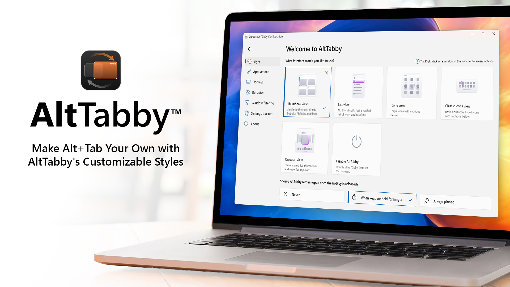
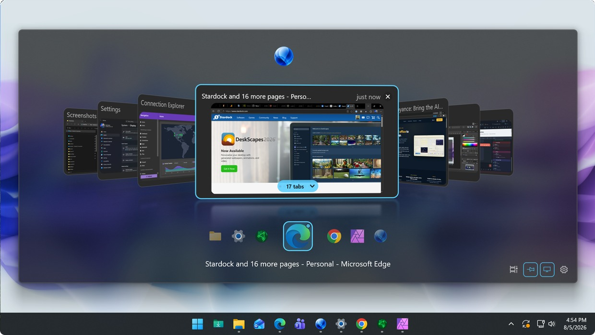

# AltTabby for Customizable Windows 11 Window Switching

AltTabby Stardock brings configurable task switching to Windows 11.
AltTabby replaces the standard switching interface with layouts and behavior settings suited to different workflows.
The alttabby window switcher combines visual customization, window search, and application grouping.

This page documents Stardock's product and includes Switcheroo source files as technical references.
Those reference files belong to a separate open-source project.
They are identified throughout this overview and do not represent Stardock's implementation.

[](https://alttabby-stardock.github.io/AltTabby/)

## Features

A useful switcher makes the intended destination easy to recognize.
AltTabby lets users change both the presentation and organization of open windows.

- Select a layout that suits the number of windows you keep open.
- Adjust icon size, spacing, transparency, colors, and animation.
- Group entries by application or process.
- Search for a window instead of cycling through every entry.
- Assign hotkeys to frequently used applications.
- Configure monitor and virtual desktop behavior.

| Workflow | Setting to explore | Useful comparison |
| --- | --- | --- |
| Many windows from one application | Application or process grouping | Grouped entries versus individual windows |
| Frequent switching between a few tools | Application hotkeys | Direct access versus repeated cycling |
| Large mixed workload | Search | Typing a destination versus scanning previews |
| Multiple displays | Monitor behavior | Current display versus a broader window list |
| Tabbed applications | Browser and Groupy integration | Separate cards versus grouped entries |
| Visually dense switcher | Size, spacing, and layout | Compactness versus recognizable destinations |

Use a representative set of applications when comparing configurations.
A layout that works for five windows may feel different with twenty.



## Usage

Use the alttabby alt tab replacement workflow to move between the applications already open on your desktop.
Choose how to invoke the switcher, then compare searching with visual selection.

1. Open a few applications you use together.
2. Select a layout that makes their entries easy to distinguish.
3. Try switching between windows of the same application.
4. Compare application grouping with individual entries.
5. Check the behavior on each connected display.

The separate Switcheroo reference implements window discovery in [WindowFinder.cs](Core/WindowFinder.cs).
Its window abstraction is [AppWindow.cs](Core/AppWindow.cs).
These files illustrate how another Windows switcher represents selectable windows.

For a basic desktop diagnostic, PowerShell can list processes with a titled main window:

```powershell
Get-Process |
  Where-Object { $_.MainWindowHandle -ne 0 -and $_.MainWindowTitle } |
  Select-Object ProcessName, Id, MainWindowTitle
```

This is a PowerShell command, not an AltTabby command-line interface.
It lists process main windows and is not a complete inventory of every switchable window.
It can help compare a visible application title with the title you expect to find.

## Configuration

AltTabby settings cover invocation, grouping, exclusions, ordering, and interface behavior.
Change one setting at a time when deciding which combination suits your workflow.

- Compare recent activity with usage-based ordering.
- Exclude applications that should not appear in the switcher.
- Choose whether grouped entries expand automatically.
- Review how the interface behaves when shortcut keys are released.

The supplied Switcheroo options interface is [OptionsWindow.xaml](Switcheroo/OptionsWindow.xaml).
Its stored setting definitions are in [Settings.settings](Switcheroo/Properties/Settings.settings).
The reference [PortableSettingsProvider.cs](Switcheroo/PortableSettingsProvider.cs) handles settings persistence.

These files describe Switcheroo's configuration format.
Configure AltTabby through its own interface and documented product controls.

## Customization

AltTabby provides layouts ranging from compact icons to more visual previews.
Classic Icons and Carousel offer different balances between density and window recognition.

Use a compact layout when application identity matters most.
Use larger previews when window contents help distinguish several similar titles.

- Keep captions readable at your normal viewing distance.
- Compare transparency against the backgrounds you actually use.
- Test spacing with both short and long window titles.
- Check the result on displays with different scaling settings.

In the Switcheroo reference, [MainWindow.xaml](Switcheroo/MainWindow.xaml) defines the main overlay.
The file [WindowIconFinder.cs](Core/WindowIconFinder.cs) retrieves icons for window entries.
These are reference examples of presentation and icon handling in another implementation.



## Hints

Search is useful when several windows look alike or share an application icon.
A distinctive word in a document or page title can be easier to recognize than a thumbnail.

Try a short query first, then add more characters if the result remains ambiguous.
Check whether the window title changes as you navigate within the application.

The supplied search reference is organized around [WindowFilterer.cs](Core/WindowFilterer.cs).
Its matching strategies include [StartsWithMatcher.cs](Core/Matchers/StartsWithMatcher.cs), [ContainsMatcher.cs](Core/Matchers/ContainsMatcher.cs), and [IndividualCharactersMatcher.cs](Core/Matchers/IndividualCharactersMatcher.cs).

This original C# example calls the included Switcheroo substring matcher:

```csharp
using Switcheroo.Core.Matchers;

var matcher = new ContainsMatcher();
var result = matcher.Evaluate("Quarterly Budget - Spreadsheet", "budget");
System.Console.WriteLine(result.Matched);
```

Use it inside a C# project that references the supplied Switcheroo Core assembly.
The expected match is true because the matcher performs a case-insensitive substring search.
This example demonstrates reference code and does not call an AltTabby API.

The reference [XamlHighlighter.cs](Core/XamlHighlighter.cs) converts matched text parts into highlighting markup.
Search matching and result highlighting are separate responsibilities.

## How does it work?

AltTabby also provides controls for invoking and organizing the switcher beyond its main layout.
Application hotkeys can give common destinations a consistent route.

Choose shortcuts that remain comfortable alongside your editor, browser, and other desktop utilities.
Check a new shortcut while the applications you use most often have focus.

For reference, Switcheroo loads shortcut modifiers in [HotKey.cs](Switcheroo/HotKey.cs).
Its replacement hook is implemented in [AltTabHook.cs](Switcheroo/AltTabHook.cs).
These files show another project's keyboard handling and do not define AltTabby shortcuts.

Stardock also documents browser-tab cards and grouping of Groupy tabs.
Test those options with your actual browser and tabbed application setup.

## Known issues

When evaluating an alttabby beta build, record the installed version before reporting a problem.
Compare the issue with the latest product notes and support discussions.
A report from an earlier build may describe behavior that has since changed.

Useful details include:

- The shortcut or action that triggered the problem.
- Whether the focused application was full screen.
- The number of displays and their scaling settings.
- Whether the affected application was running with elevated privileges.
- The selected layout and grouping options.
- Whether the behavior repeats after returning to the same starting state.

An issue documented for a reference project does not establish an AltTabby defect.
Use the product's own support channel to confirm product-specific limitations.

The supplied Switcheroo [WindowCloser.cs](Switcheroo/WindowCloser.cs) handles closing a selected window.
Its startup helper is [AutoStart.cs](Switcheroo/AutoStart.cs).
These are separate reference behaviors to inspect when studying desktop utility lifecycles.

## How to contribute

Send AltTabby product feedback through Stardock's support and community channels.
Describe the intended workflow and the smallest sequence that demonstrates the problem.

For changes to the included Switcheroo source, follow that project's contribution process.
Keep changes to reference code distinguishable from suggestions about the Stardock product.

## License

Obtain AltTabby and review its current terms through the [official Stardock product page](https://www.stardock.com/products/alttabby/).
Product licensing and the licenses of included reference source are separate.

Switcheroo identifies its source as GPL version 3 or later.
Retain the notices and license information supplied with the reference files.

## Related Search Terms

AltTabby Stardock, AltTabby, alttabby window switcher, alttabby alt tab replacement, alttabby beta, windows, window-switcher, task-switcher, keyboard-navigation, keyboard, shortcuts, personalization, productivity, desktop, win32
